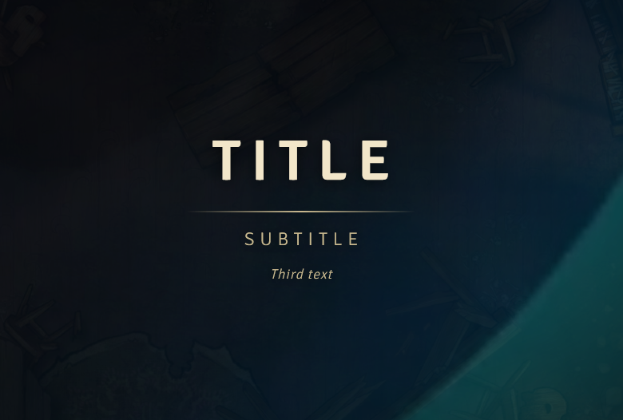
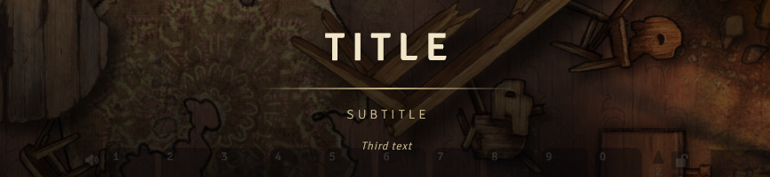

<!-- Synced with README.fr.md at version 1.3.1 -->
English | [Français](README.fr.md)

<div align="center">

# Session Title Card

**A clean title card on all your players' screens, in two clicks.**


[Installation](#installation) · [Quick start](#quick-start) · [Automatic cards](#automatic-cards) · [Settings](#settings) · [Troubleshooting](#troubleshooting)

</div>

<table>
  <tr>
    <td align="center" width="50%">
      <br>
      <sub>Full screen card</sub>
    </td>
    <td align="center" width="50%">
      <br>
      <sub>Banner: the game stays usable</sub>
    </td>
  </tr>
</table>

## What it does

| Type | Description |
| --- | --- |
| **Full screen card** | Title, subtitle, ambience text, background image and intro sound, with fades. |
| **Banner** | Announces a place or a date at the bottom of the screen, without blocking the game. |
| **Per-scene card** | Shows up by itself when a player arrives on the scene. |
| **Combat card** | Banner at the start and at the end of every combat (off by default). |

- **Fast**: title, subtitle, live preview, then "Show to everyone".
- **In control**: choose the recipients, presets, automatic session number (`{{n}}`).
- **Player friendly**: everyone can skip or turn off automatic cards on their side.
- **Lightweight**: no dependency, no network call, works with any game system.

## Installation

In Foundry: **Add-on Modules**, then **Install Module**. Paste the address below into **Manifest URL**, click **Install**, then enable the module in your world.

```
https://github.com/MrAlex34374/Session-Title-Card/releases/latest/download/module.json
```

<details>
<summary>Manual installation (copy the folder)</summary>

1. Copy the `session-title-card` folder into `Data/modules`.
2. Check that `module.json` sits directly in that folder.
3. Reload the module list (back to the setup screen, then relaunch the world).
4. In the world: **Manage Modules**, tick **Session Title Card**.

</details>

## Quick start

1. Open the window: the **Title Card** tool (clapperboard icon) in the token controls, or the **Title Card** macro created automatically.
2. Type a title and a subtitle, pick *Full screen card* or *Banner*, then a duration.
3. Click **Show to everyone**. To try it on your own screen first: **Preview (me only)**.

> [!TIP]
> Esc or the button at the bottom right closes the card for everyone. The banner only closes with its button.

## Automatic cards

**Per scene.** In a scene's configuration, the **Automatic title card** block describes a card shown to every player who arrives on the scene (activation, scene change, token teleport).

- Players can skip it after 1.5 s, or turn these cards off in their own settings.
- A card you send by hand always takes priority.
- The **Only once** option does not replay the card before the next session number.

> [!WARNING]
> Players can read the content of that block (browser console). Put no secret in it.

**In combat.** A banner announces the start and the end of every combat, with a phrase picked at random from your lists (separated by `|`).

> [!IMPORTANT]
> Combat cards are off by default..

## Settings

In **Settings > Game Settings > Session Title Card**.

| Setting | Scope | Default |
| --- | --- | --- |
| Font, colors, title size, shadow | World | Signika, `#f2e6c9` / `#c9b98f`, 72 px, soft |
| Full screen card durations and opacity | World | 1.5 s / 5 s / 1.5 s, 0.92 |
| Automatic per-scene title cards | World | On |
| Automatic combat cards and their phrases | World | Off |
| Intro sound and volume | Each player | Sound on, volume 0.8 |
| Show scene cards, combat cards, GM side | Each user | On |

Every setting, the window and the exact behavior are described in the [detailed documentation](docs/DETAILS.md). The API for your macros is in [docs/API.md](docs/API.md).

## Troubleshooting

<details>
<summary>A player sees nothing</summary>

Check the **Audience** tab (they may be unticked), that the player is connected when you click, and that you are logged in with a GM role account (an "assistant GM" account is not treated as a GM).

</details>

<details>
<summary>No sound for a player</summary>

Browsers block audio until the page has received a click. The player must have clicked once in the page, check that "Disable intro sound" is unticked and that their interface volume is not at zero.

</details>

<details>
<summary>The image does not show</summary>

The path must be local, relative to the Foundry root (for example `assets/map.webp`), without `..`, with an image extension. Videos are not accepted. The banner does not use an image.

</details>

<details>
<summary>The automatic card does not show</summary>

Check that "Enable" is ticked in the scene block, that the world setting "Automatic per-scene title cards" is on, and that the scene is active if you test as the GM. The browser console (F12) tells you why for combat cards, on lines starting with `session-title-card |`.

</details>

<details>
<summary>The module or the tool does not appear</summary>

Check that `module.json` sits directly in `Data/modules/session-title-card` and that the module is enabled. The tool is only visible to the GM, in the token controls group.

</details>

## Compatibility and license

Foundry VTT v13 minimum, v14 verified. Independent of the game system. Known limit: the per-scene card triggers when the player's view changes scene, so token teleports are only covered when they change that view.

[Report a problem](https://github.com/MrAlex34374/Session-Title-Card/issues) · [Changelog](CHANGELOG.md) · [MIT license](LICENSE)
